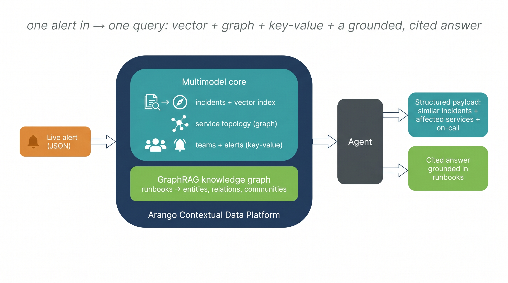
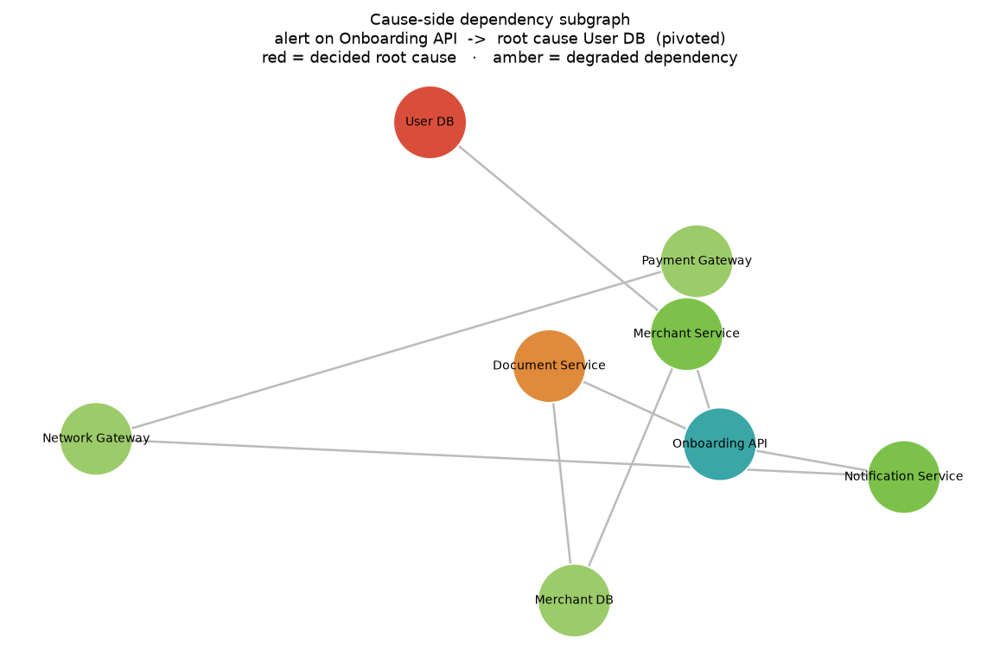
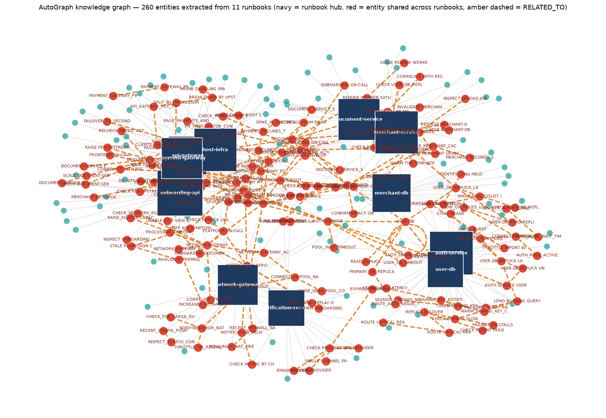
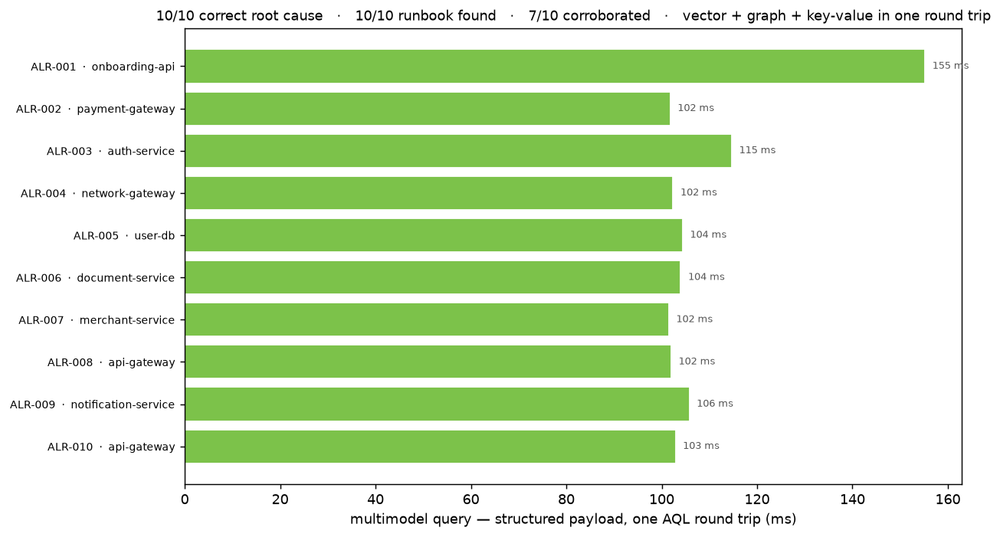

# Incident-Resolution Agent on Arango

A support-engineering agent built on the [Arango Contextual Data Platform](https://docs.arango.ai/agentic-ai-suite/). When a live alert
comes in, one pass returns the most similar past incidents, the likely root cause, the services
that would be affected, the on-call owner, **and** a cited, runbook-grounded next step. Tickets,
service topology, health, alerts, and runbooks all live in **one** deployment: no separate vector
store, no graph database, no stitched-together pipeline.

The hero case the tutorial follows is a **P1 alert on `onboarding-api`**: one AQL query returns 3
similar past incidents (vector), the dependency and impact subgraphs (graph), the per-scenario
service health (key-value), and the on-call team (key-value) in a single round trip. A reasoning
step then decides the true root cause, pivoting from the alerting service to a degraded
dependency when the health and symptom support it, and the AutoGraph knowledge graph grounds a
natural-language fix in that service's runbook.

Across the 9 demo alerts the agent names the correct root cause for each, scored against a
per-alert answer key rather than a self-check that always passes. The confidence it reports is
derived from the graph evidence and spans three tiers (high, medium, low). It is the
support-engineering use case Zscaler runs in production at scale (40K+ daily AI requests on the
same platform); here it is simulated end to end on a public dataset you can run yourself.

## Contents
- [How it works](#how-it-works)
- [The hero alert](#the-hero-alert)
- [The marquee query](#the-marquee-query)
- [Results](#results)
- [Repository layout](#repository-layout)
- [The dataset](#the-dataset)
- [Prerequisites](#prerequisites)
- [Setup](#setup)
- [Running the pipeline](#running-the-pipeline)
- [Models](#models)
- [Status](#status)
- [Attribution](#attribution)

## How it works

Two surfaces over one platform, joined by the agent.



| Layer | Built by | What it contributes |
|-------|----------|---------------------|
| Multimodel core | `src/ingest.py` | Incidents with embeddings, a curated service topology (named graph), per-scenario service health, on-call teams, and stored alerts, all in database `incident_demo` |
| Vector recall | `src/ingest.py` | Past incidents embedded for similarity search via `APPROX_NEAR_COSINE` |
| Service graph | `src/ingest.py` | The `service_topology` named graph: who depends on whom, traversed outbound for possible causes and inbound for the blast radius |
| Reasoning / pivot | `src/resolver.py` | Decides the true root cause: pivots from the alerting service to a degraded dependency when the per-scenario health and the symptom support it, and reports a confidence tier derived from that evidence |
| Knowledge graph | AutoGraph (web UI) + the Retriever | The cited reason a fix applies, built from the runbook corpus |

A single AQL query (the "marquee") resolves the vector recall of similar incidents, the
dependency and impact subgraphs, the per-scenario health, and the on-call owner in one round
trip, with no application-side joins. The agent (`src/resolver.py`) then decides the root cause
from that evidence and grounds the answer in that service's exact runbook, with a **semantic**
Retriever pass (Unified Search, `query_type 3` in the API; Instant Search in the UI) adding the
related runbooks. Precise scope, grounded context.

## The hero alert

`python src/resolver.py data/alert.sample.json` on a P1 `onboarding-api` alert returns a single
JSON payload:

- **`structured`** (one AQL round trip, then the reasoning step):
  - `similar_incidents`: 3 ranked past incidents with their resolutions (vector, [`APPROX_NEAR_COSINE`](https://docs.arango.ai/arangodb/stable/aql/functions/vector/))
  - `possible_causes`: the services the alerting service depends on, by depth, each with its health status (graph, `OUTBOUND` traversal) — this is where a cause can live
  - `impacted_services`: the services that depend on the alerting service (graph, `INBOUND` traversal) — the blast radius
  - `root_service`, `reasoning`, `confidence`, `judge_confidence`, `confidence_basis`: the decided root cause and why, with a confidence derived from the graph (the model's own self-report is kept separately and can only lower the tier, never raise it)
  - `on_call`: the owning team and contact (key-value, `DOCUMENT` lookup)
- **`cited_answer`**: a natural-language next step from the Retriever, with its own citations under
  the Retriever's numbering, plus `primary_runbook`: the exact runbook for the decided root
  service, read from the knowledge-graph store.
- **`corroboration`**: an independent check that the Retriever's own retrieval surfaced the
  decided root service's runbook, so the structured surface and the semantic surface agree. It is
  not derived from the pick, so it can disagree.

The cause-side subgraph shows the decided root cause in red and any degraded dependency in amber,
so a pivot is visible: on the hero alert the alarm is on `onboarding-api`, but the root cause is
`user-db` two hops away.



The runbooks import into a real knowledge graph: each runbook a hub, entities clustering around
it, with the entities that appear in more than one runbook bridging them (red).



> Both data figures are regenerated from the live deployment by `python src/viz.py` (into
> `assets/`). The headline architecture diagram is a static asset;
> `assets/architecture-schematic.png` is the same architecture rendered purely from code if you
> would rather have a reproducible version.

## The marquee query

One store, one language, several moves in one round trip (`src/resolver.py:MARQUEE`):

- [`APPROX_NEAR_COSINE(i.embedding, @vec)`](https://docs.arango.ai/arangodb/stable/aql/functions/vector/): nearest past incidents (vector)
- `0..3 OUTBOUND ... GRAPH "service_topology"`: the dependency subgraph (possible causes), deduped to shortest depth (graph)
- `1..3 INBOUND ... GRAPH "service_topology"`: the dependents (the blast radius), deduped to shortest depth (graph)
- `DOCUMENT("service_health", CONCAT(@scenario, "__", v._key))`: each service's health in this alert's scenario (key-value)
- `DOCUMENT("teams", DOCUMENT("services", root).team)`: on-call owner (key-value)

## Results

Every alert in `data/alerts.json`, end to end. Section 7 of the notebook runs `evaluate()` over
the whole set and times both halves of each resolution: the multimodel query (one AQL round trip)
and the cited answer from the Retriever.



For every alert the agent names the correct root cause, scored against a per-alert `expected_root`
answer key, so the score can actually fail (changing a key to a wrong value drops it). A runbook
is located for the decided root (`runbook_found`), and the Retriever's own retrieval independently
corroborates it. The multimodel query itself returns in a few milliseconds; the cited answer adds
one Retriever round trip on top. The per-alert table (similar incident, possible causes, blast
radius, on-call owner, runbook, confidence, both timings) renders in the notebook.

## Repository layout

```
.
├── incident_resolution.ipynb        # narrated, executed walkthrough of the full flow
├── requirements.txt
├── .env.example
│
├── src/
│   ├── ingest.py                    # multimodel core: schema, embed tickets + seeds, build topology, per-scenario health, store alerts
│   ├── graphrag.py                  # auth + service discovery + the KG runbook lookup
│   ├── graphrag_ingest.py           # build the runbook KG with AutoGraph (import -> corpus build -> strategizer -> orchestrate) + verify
│   ├── resolver.py                  # the marquee AQL query + reasoning/pivot + cited grounded answer + corroboration + evaluate()
│   ├── run_all.py                   # the whole pipeline in one command (verify-only by default)
│   └── viz.py                       # regenerate the figures from live data (subgraph, KG, results)
│
├── data/
│   ├── topology.json                # curated service topology (12 services, 13 dependencies, 5 teams)
│   ├── service_signals.json         # per-scenario service health (which services are degraded in each incident scenario)
│   ├── seed_incidents.json          # 47 curated past incidents that relate to the scenarios
│   ├── alerts.json                  # 9 synthetic alerts; alert.sample.json is the headline P1
│   └── runbooks/                    # 11 hand-authored runbooks (the cited knowledge-graph corpus)
│
├── docs/                            # provisioning walkthrough for the AutoGraph services
├── tests/                           # unit tests for the reasoning / scoring / citation logic
└── assets/                          # architecture diagram + the data-driven figures
```

## The dataset

| Shape | Source | Notes |
|---|---|---|
| Incident tickets | [`6StringNinja/synthetic-servicenow-incidents`](https://huggingface.co/datasets/6StringNinja/synthetic-servicenow-incidents) (HF, MIT, 500 rows) | Loaded at runtime, not vendored. Embeds `short_description + description`; keeps `resolution`. Background volume; unmatched rows are labelled `unknown`, not a real service. |
| Seed incidents | `data/seed_incidents.json` (47 curated) | Past incidents that actually relate to the scenarios, so similarity recall has real signal, not only noise. Includes the user-db / e-sign cases behind the hero alert. |
| Per-scenario health | `data/service_signals.json` | Which services are degraded in each incident scenario. One scenario degrades two services (a true cause and a decoy); one degrades none (the low-confidence case). |
| Live alerts | `data/alerts.json` (9 synthetic) | Varied service, severity, region, telemetry. Each carries a `scenario` and an `expected_root` answer key. |
| Runbooks | `data/runbooks/` (11 hand-authored, by service-family module) | The cited source-of-truth knowledge graph. |

The data is a **simulation** of an incident estate (breadth across P1 to P3 and across infra to
app services), disclosed as synthetic. The service topology is hand-curated
(`data/topology.json`) since the dataset ships no CMDB; in production you would derive it from
your real service map. For a larger, real corpus,
[`Loukh1/IT-incidents`](https://huggingface.co/datasets/Loukh1/IT-incidents) (MIT, 4,040 rows)
is the documented scale-up path.

## Prerequisites

- An **Arango Managed Platform** deployment with the **Contextual Data Platform** profile
  enabled (this unlocks AutoGraph and the Retriever).
- **Python 3.12**
- An **OpenAI API key**

## Setup

Clone the repo and install dependencies:

```bash
pip install -r requirements.txt
```

Copy `.env.example` to `.env` and fill in your credentials:

```
ARANGO_HOST=https://<your-deployment>.arango.ai
ARANGO_DB=incident_demo
ARANGO_USER=<user>
ARANGO_PASSWORD=<password>
OPENAI_API_KEY=<your-key>
GRAPHRAG_DB=incident_demo
GRAPHRAG_PROJECT=incident-runbook-autograph
```

`GRAPHRAG_DB` and `GRAPHRAG_PROJECT` point at the AutoGraph project whose knowledge-graph
collections live in the same database as the multimodel core. `src/graphrag.py` and
`src/graphrag_ingest.py` use the same default project name, and the Retriever and AutoGraph
service postfixes are discovered at runtime (`src/graphrag.py`), so no service IDs are hardcoded.

> On Apple Silicon, run the scripts with `arch -arm64 python3 ...` (the Python here is a universal
> binary).

## Running the pipeline

The runbook knowledge graph is built once through the AutoGraph web UI; the multimodel core and
the resolver run from the scripts (or the notebook). In order:

**1. Build the multimodel core.**

```bash
python src/ingest.py   # 500 incidents + 47 seeds + 9 alerts + topology + per-scenario health in incident_demo
```

**2. Build the runbook knowledge graph (AutoGraph web UI).** Create an AutoGraph project through
the wizard (Documents, Configure, Build): upload the 11 runbooks in `data/runbooks/` as a
category, choose the chat and embedding models, and start the build, which deploys the AutoGraph
service and builds the Corpus Graph. From the project overview, generate strategies, review the
per-cluster strategy and ontology, and click **Continue to build** to build the Knowledge Graph.
See `docs/` for the full walkthrough.

The import, corpus, and strategizer steps are also scriptable over the documented
[AutoGraph REST API](https://docs.arango.ai/agentic-ai-suite/autograph/reference/) via
`python src/graphrag_ingest.py` (skip-if-built; `--reset` to rebuild). Use the wizard **or** the
script for a given project, not both, since each imports the corpus. The final entity build
(`orchestrate`) returns 0 jobs over REST on this platform version, so it is the one step that
must be done with the UI's **Continue to build** button. The wizard is the path this tutorial
follows.

**3. Deploy a Retriever.** Once the Knowledge Graph exists, deploy a Retriever from the project
overview (**Deploy a retriever**). The resolver queries it for the cited answer. If it is not
running, the resolver still returns the decided root cause and that service's runbook, and marks
the result degraded rather than failing.

**4. Resolve an alert.**

```bash
python src/resolver.py data/alert.sample.json   # one alert -> structured payload + cited, grounded answer
python src/run_all.py                           # or the whole pipeline (verify stores, then resolve)
```

`run_all.py` is verify-only by default: it does not rebuild the operational store or re-import the
knowledge graph if they already exist (pass `--rebuild` to reload the operational store).

The notebook `incident_resolution.ipynb` walks the same flow, importing the same functions from
`src/`. The cited answer uses the Retriever's Unified Search (`query_type 3` in the API; the web
UI exposes the equivalent as Instant Search, alongside Deep Search for a multi-step answer).

## Models

The pipeline uses `text-embedding-3-small` (1,536 dimensions) for all embeddings, on both the
ingest and query sides, so the vector spaces match. The agent's reasoning uses `gpt-5-mini`
(set in `src/resolver.py`). The reasoning step is the only non-deterministic part; the reported
confidence is derived from the graph, so the tier is stable even when the model's self-report
varies.

## Status

- Multimodel core ✅ — incidents, seeds, per-scenario health, topology, alerts.
- AutoGraph runbook knowledge graph ✅ — import, corpus build, and strategizer run via the
  AutoGraph REST API; the Knowledge Graph is built from the project overview in the UI.
- Reasoning + cited, grounded resolver ✅ — pivots to the true root cause using per-scenario
  health; the cited fix is grounded in that service's runbook; across the 9 demo alerts the agent
  names the correct root cause (scored against an answer key), and the Retriever's retrieval
  independently corroborates each one.
- Tests ✅ — unit tests for the reasoning, scoring, and citation logic in `tests/`.

## Attribution

Built on the [Arango Contextual Data Platform](https://arango.ai/). Incident tickets from
[`6StringNinja/synthetic-servicenow-incidents`](https://huggingface.co/datasets/6StringNinja/synthetic-servicenow-incidents)
(MIT). Alerts, runbooks, seed incidents, and service topology are synthesized for this tutorial.
The agent here is framework-free Python; LangChain / LangGraph and Arango's built-in **Ada**
assistant are documented extension points.